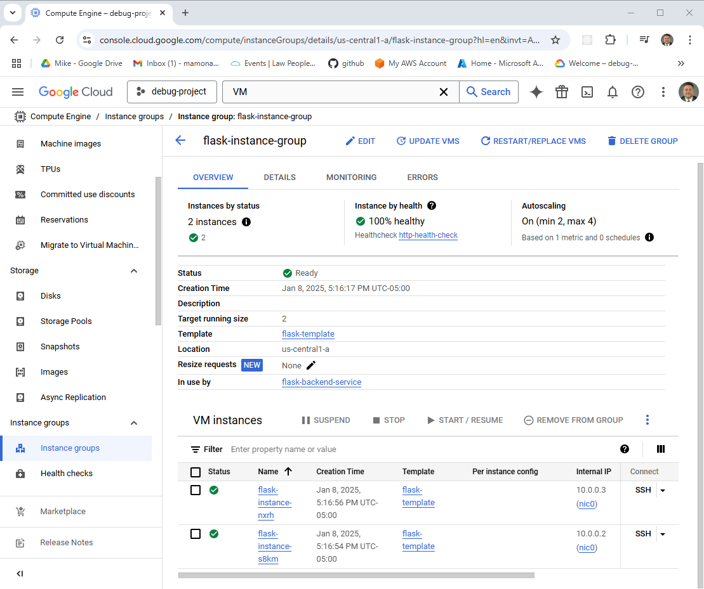
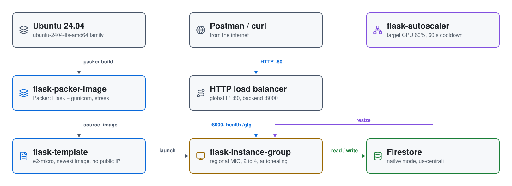
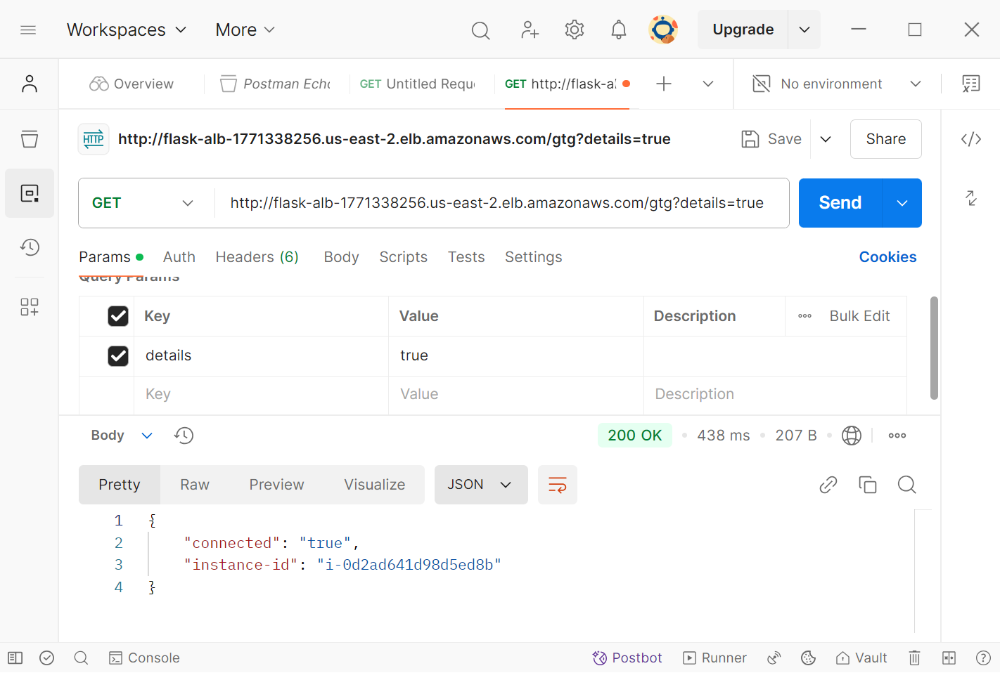

# Flask Microservice on a GCP Managed Instance Group

Part 3 of the series
[Scaling in the Cloud: AWS Auto Scaling, Azure VMSS, and GCP MIGs](https://youtu.be/fogz73FXJEA).
A small Flask service that stores candidates in **Firestore** is baked into a
Compute Engine image with **Packer**, then run behind a global **HTTP load
balancer** in a regional **managed instance group** that adds and removes
instances on CPU load.



| Piece | Where | Role |
|---|---|---|
| **flask-packer-image** | image family `flask-images` | Ubuntu 24.04 + the Flask app under gunicorn (systemd), `stress` for load tests |
| **flask-template** | instance template | `e2-micro` from the newest image; no public IP; tags `allow-flask`, `allow-ssh` |
| **flask-instance-group** | `us-central1` (regional) | 2 to 4 instances; named port `http` = 8000; autohealing on `/gtg` after 300 s |
| **flask-autoscaler** | `us-central1` | target 60% CPU, 60-second cooldown |
| **HTTP load balancer** | global | `flask-lb-ip` on 80, `flask-http-proxy`, URL map `flask-alb`, `flask-backend-service` |
| **Firestore** | `us-central1` | native mode database, created by `api_setup.sh` |
| **Cloud NAT** | `us-central1` | outbound internet for the instances |

## Architecture

<picture>
  <source media="(prefers-color-scheme: dark)" srcset="architecture-dark.svg">
  
</picture>

Regenerate with `python3 make_diagram.py`.

- **`01-infrastructure/`**: the VPC (`flask-vpc`) with `flask-subnet`
  (10.0.0.0/24), the firewall rules, Cloud Router and NAT, the `/gtg` health
  check, and the service account's `roles/datastore.user` binding.
- **`02-packer/`**: `flask_image.pkr.hcl`, `install.sh` and the app in
  `scripts/`.
- **`03-mig/`**: the instance template, the instance group and autoscaler,
  and the load balancer.
- **`build/`**: the per-phase scripts `apply.sh` and `destroy.sh` call, in
  Bash and PowerShell, plus `api_setup.sh`.

## How it builds

1. **Phase 1**: Terraform builds the network, NAT, health check and IAM.
2. **Phase 2**: Packer builds `flask-packer-image-<timestamp>` in the
   `flask-images` family.
3. **Phase 3**: Terraform finds the newest image and builds the template,
   instance group, autoscaler and load balancer.

## How it scales

The autoscaler keeps the group's average CPU near **60%**, between 2 and 4
instances, waiting 60 seconds after a new instance starts before using its
metrics. Unhealthy instances are recreated by autohealing.

## API

| Method | Path | Returns |
|---|---|---|
| GET | `/gtg` | 200; with `?details=true`, connection and instance details |
| GET | `/candidate/<name>` | the candidate, or 404 |
| POST | `/candidate/<name>` | `{"CandidateName": <name>}`, or 500 |
| GET | `/candidates` | every candidate, or 404 |

## Firewall rules

```
internet ─80─▶ HTTP load balancer ─8000─▶ flask-instance-group
```

`allow-http` (80), `allow-flask` (8000) and `allow-ssh` (22) allow
`0.0.0.0/0`; `allow-firestore` allows egress on 80 and 443. The instances
have no public IPs.

## Prerequisites

* [A Google Cloud Account](https://console.cloud.google.com/)
* [Install gcloud CLI](https://cloud.google.com/sdk/docs/install)
* [Install Terraform](https://developer.hashicorp.com/terraform/install)
* [Install Packer](https://developer.hashicorp.com/packer/install)

Put a service account key in the repository root as `credentials.json`.
Terraform, Packer and the instances use it. If this is your first time
watching our content, we recommend starting with this video:
[GCP + Terraform: Easy Setup](https://youtu.be/3spJpYX4f7I).

## Deploy

```bash
git clone https://github.com/mamonaco1973/gcp-flask-mig.git
cd gcp-flask-mig
./build/api_setup.sh   # first time: enables the APIs and creates the Firestore database
./apply.sh             # or .\apply.ps1
```

Everything deploys to `us-central1`. `apply.sh` ends by running
`validate.sh`, which waits for the load balancer and runs the smoke test:

```
NOTE: Health check endpoint is http://203.0.113.10/gtg?details=true
✓ good to go passed
✓ insert passed
✓ verification passed
✓ candidate list passed
```

## Try it

1. Open the `/gtg?details=true` URL in Postman (or `curl`) a few times: the
   instance changes as the load balancer spreads requests.

   

2. Load the group: the instances have no public IP, so connect with
   `gcloud compute ssh <instance> --tunnel-through-iap` and run
   `stress --cpu 2 --timeout 600`. The autoscaler adds instances as CPU
   climbs past 60% and removes them after the load stops.

## Teardown

```bash
./destroy.sh     # or .\destroy.ps1: destroys the group and load balancer, then the network, then deletes the images
```

## Notes

- **Lab only.** The load balancer is plain HTTP, and the instances run as the
  same service account as Terraform with the `cloud-platform` scope.
